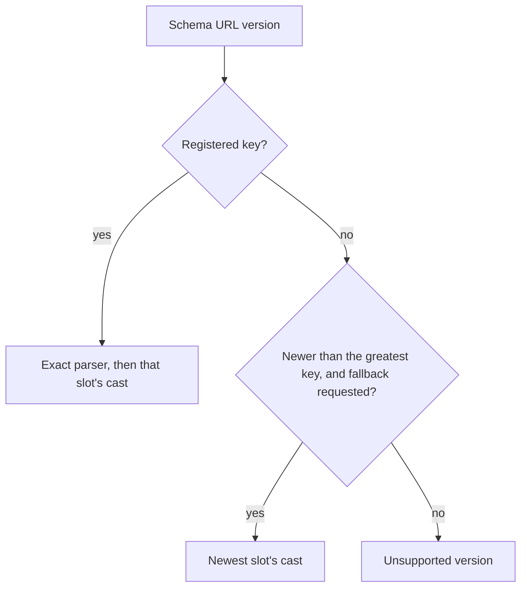

# 6. Freshness artifact and version-keyed dispatch

Date: 2026-10-20

## Status

Accepted

## Context

dbt 2 publishes `freshness.json` with schema version 0. The parser treated schema versions as a contiguous range that starts at 1, and it treated the length of that list as the newest version. Version 0 is a legal document. A list whose length is 1 is not a newest version of 0, so a later freshness version would not fall back to v0.

`freshness.json` is not a sources document. Its result status stays `Pass`, `Warn`, or `Error`, and each result names a source or a model. `parseSources` on a freshness schema URL has to reject the document.

dbt 2 writes sources with the existing sources v3 schema URL. In that document, `Pass`, `Warn`, and `Error` replace the lowercase spellings from dbt 1. The value `runtime error` and any other string stay as written. The parser returns the caller object, so a rewrite has to copy first. A document that is already lowercase comes back as the same object.

The package root re-exports catalog only. Sources already exports a type named `FreshnessExecutionResultArtifact`, and the freshness schema uses that same title.

## Decision

Freshness is its own category, starting at v0. Callers import it from the freshness entry. The package root stays a catalog re-export.

Dispatch keys are the integers in `metadata.dbt_schema_version`. The newest version is the greatest registered key, computed when the table is built. An empty table, a duplicate key, or a negative version is rejected at construction. Fallback applies only when the caller asks for it and the document version is greater than that greatest key. Fallback uses the newest slot's cast. It does not pretend the newer URL is an older exact version.

Sources v3 has one cast. That cast rewrites only `Pass`, `Warn`, and `Error` to `pass`, `warn`, and `error`. When any row changes, the cast copies the root, the results array, and the changed rows, and it leaves the caller object untouched. When no row changes, the cast returns the same object. The exact v3 parser and the fallback path both use this cast. Other sources versions do not rewrite status.

Freshness v0 does not rewrite status.

## Consequences

**Positive:**

- A category whose only schema is v0 has newest version 0.
- Manifest, catalog, run results, and sources use the same key rule, so the next category does not copy a 1-based index.
- A sources document that dbt 1 already wrote in lowercase is returned unchanged.
- A freshness schema URL cannot be parsed as sources.

**Negative / risks:**

- The dispatcher and the exact parser both check the schema URL on a known version.
- A sources rewrite shares nested values, such as criteria and timing, with the caller.
- The freshness schema title matches a sources type name. The freshness entry exports that generated root as `FreshnessArtifact` and does not re-export the generated name.

## Alternatives considered

- **Offset the parser list so version 0 lands at index 0.** The newest version can be defined from the offset and the length, which fixes the v0 fallback number. The index is still arithmetic. A gap, or a copy of `parsers[version - 1]`, selects the wrong parser. The map has no offset to forget.
- **Special-case freshness and leave the other categories on lists.** The next 0-based category copies whichever file it opens. Sources fallback would keep a second cast unless both arms are updated together.
- **Parse `freshness.json` with the sources v3 parser.** The schema title matches. The call sites do not. Freshness status must stay `Pass`, `Warn`, and `Error`, and a freshness URL must not parse as sources.
- **Lowercase every sources status, or validate the document with a schema library.** Lowercasing also rewrites strings that must stay, including `runtime error`. A validator replaces the URL check and the cast and adds a dependency.

## References

- Published freshness schema: <https://schemas.getdbt.com/dbt/freshness/v0.json>
- [0001](./0001-record-architecture-decisions.md) for what belongs in an ADR
